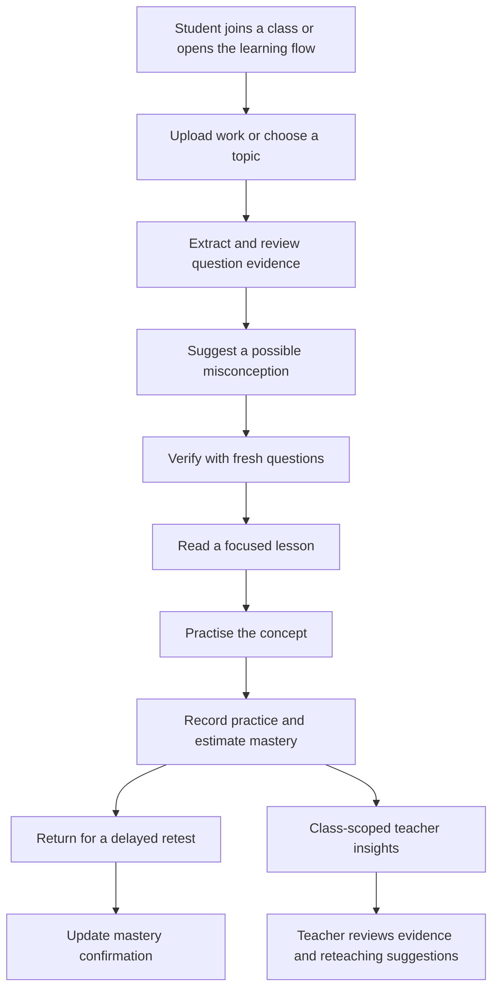

# LearnLens AI

**Understand the mistake. Fix the idea.**

LearnLens AI is an adaptive-learning prototype designed to help students understand *why* an answer may be wrong, verify a possible learning gap, study a focused explanation, practise again, and help teachers identify patterns across a class.

> **Project status:** Hackathon / research prototype. Learning diagnoses and mastery values are estimates to support student and teacher review. They are not formal grades, clinical-style diagnoses, or evidence of learning improvement without a properly evaluated pilot.

## Contents

* [Why LearnLens](#why-learnlens)
* [Features](#features)
* [How the learning flow works](#how-the-learning-flow-works)
* [Technology and architecture](#technology-and-architecture)
* [Quick start: local demo](#quick-start-local-demo)
* [Real-data setup with Supabase](#real-data-setup-with-supabase)
* [Environment variables](#environment-variables)
* [Routes and pages](#routes-and-pages)
* [Tests and verification](#tests-and-verification)
* [Deploying to Vercel](#deploying-to-vercel)
* [Privacy, security, and responsible use](#privacy-security-and-responsible-use)
* [Project structure](#project-structure)
* [Documentation](#documentation)
* [Known limitations](#known-limitations)

## Why LearnLens

Students often receive marks without a useful explanation of the misconception behind a mistake. Teachers may see similar errors across a class but have limited time to provide individual follow-up. LearnLens is designed to connect a student's work to targeted learning actions and class-level teaching signals.

|Students can|Teachers can|
|---|---|
|Join a class using a nickname and class code|Create a classroom and share its class code|
|Upload supported work or use a bundled sample worksheet|View the roster for their authorised class|
|Review extracted work and possible learning gaps|Review a student-by-concept mastery heatmap|
|Answer fresh diagnostic questions|Identify recurring misconception tags|
|Read focused lesson notes and practise|Generate a draft reteaching plan|
|Review progress and due retests|View class feedback and export available evidence to CSV|
|Use the available privacy/data-deletion controls|Use evidence to inform—not replace—teacher judgement|

The bundled teaching notes cover mathematics topics and include English, Hindi, and Kannada lesson support where available. The current content bundle is local and does not require a vector database.

## Features

* **Work review:** Supports PDF and common image uploads within the configured size limit. The included fictional sample worksheet can be used without uploading personal schoolwork.
* **Evidence-first diagnosis:** A possible misconception is presented as a hypothesis with supporting evidence, rather than a definitive label.
* **Understanding checks:** Generates or selects follow-up questions to test whether the suspected gap is consistent with the learner's answers.
* **Targeted lessons:** Retrieves relevant teaching notes from the bundled content files; optional AI providers can assist with supported flows when configured.
* **Practice and delayed retest:** Tracks practice outcomes and uses a mastery estimate. Mastery remains provisional until the relevant confirmation/retest condition is met; the intended retest interval is at least 24 hours.
* **Teacher dashboard:** Shows class-specific student/concept signals, provisional mastery, recurring misconceptions, feedback summaries, a reteaching-plan draft, and exportable evidence.
* **Optional integrations:** Supabase for persistent classroom records and optional OpenRouter/Gemini provider credentials for AI-assisted features.
* **Fallback behaviour:** Some learning flows use bundled content and deterministic/rules-based fallbacks when a live provider is not configured or available. The UI/API should be checked for fallback indicators before interpreting a result as live AI output.

## How the learning flow works



The system's diagnosis is intended to be **explainable and reviewable**. Teachers and students should be able to inspect the supporting evidence and correct extraction errors where the interface supports it.

## Technology and architecture

|Layer|Technology|Responsibility|
|---|---|---|
|Frontend|Next.js, React, TypeScript, Tailwind CSS|Homepage, student journeys, feedback, teacher dashboard, and frontend API proxy|
|Backend|Python, FastAPI, Pydantic|Learning workflows, classroom operations, analysis endpoints, teacher analytics, and health checks|
|Document processing|PyMuPDF and Pillow|Extract text from supported PDFs/images and validate/process upload content|
|Learning content|`content/notes.json`, `content/misconceptions.json`|Bundled lesson notes and misconception catalog|
|Optional AI|OpenRouter and/or Gemini|Provider-assisted supported workflows when configured|
|Persistence|In-memory local store by default; Supabase optional|Classroom, student, learning-event, feedback, and related records|
|Deployment|Two Vercel projects or separate compatible hosts|Frontend and backend are deployed independently|

The frontend calls its own `/api/*` route, which proxies requests to the backend using the server-side `AI_SERVICE_URL`. The provider keys and Supabase secret must remain on the backend, never in browser-exposed variables.

## Quick start: local demo

### Requirements

* Python **3.11 or newer**
* Node.js **20.9 or newer**
* npm (bundled with Node.js) or pnpm
* Git, if you are cloning the repository

### 1. Get the project

```bash
git clone <YOUR_GITHUB_REPOSITORY_URL>
cd LearnLens_AI_Hackathon_Submission
```

Or download and extract the ZIP, then open a terminal in the extracted repository root.

### 2. Start the backend

**Windows Command Prompt:**

```bat
cd backend
py -3.11 -m venv .venv
.venv\Scripts\activate.bat
python -m pip install --upgrade pip
pip install -r requirements.txt
python -m uvicorn app.main:app --reload --port 8123
```

**Windows PowerShell:**

```powershell
cd backend
py -3.11 -m venv .venv
.\.venv\Scripts\Activate.ps1
python -m pip install --upgrade pip
pip install -r requirements.txt
python -m uvicorn app.main:app --reload --port 8123
```

**macOS/Linux:**

```bash
cd backend
python3.11 -m venv .venv
source .venv/bin/activate
python -m pip install --upgrade pip
pip install -r requirements.txt
python -m uvicorn app.main:app --reload --port 8123
```

Leave the backend terminal running. Health endpoint: [http://127.0.0.1:8123/health](http://127.0.0.1:8123/health).

### 3. Start the frontend

Open a **second terminal** at the repository root:

```bash
cd web
npm install
npm run dev
```

Open [http://localhost:3000](http://localhost:3000).

The repository includes a pnpm lockfile; pnpm may also be used if it is installed:

```bash
cd web
pnpm install
pnpm dev
```

### Local demo data rules

A clean local checkout, with **no actual `.env` / `.env.local` file and no service credentials**, enables a clearly synthetic judge walkthrough. It includes a fictional `CSE-A` classroom and the local demo teacher key `demo-teacher-key`.

* This is **synthetic demo data**, not a real class or real student activity.
* A clean checkout is the only intended place where the automatic sample teacher roster is enabled.
* Creating a project `.env` file, or supplying real service credentials, switches the teacher UI to real-data mode and disables the synthetic classroom.
* Hosted environments such as Vercel must never expose the synthetic classroom, even if a demo-related variable is accidentally set.
* Do not use the demo teacher key or sample records on a deployed site.

To walk through the sample: open `/teacher`, use `CSE-A` with `demo-teacher-key` if prompted, open `/join` in another browser/profile, join with a nickname and consent, and then work through the student journey.

## Real-data setup with Supabase

Use this mode when you want classes and student learning evidence to be stored in a database. **Do not use the local sample roster as real student data.**

### 1. Create a Supabase project

Create a project from the [Supabase Dashboard](https://supabase.com/dashboard). Keep credentials private.

### 2. Create the schema

For a **fresh, empty** database:

1. Open Supabase **SQL Editor**.
1. Open the repository file [`supabase/schema.sql`](supabase/schema.sql), copy its full contents, and run it.
1. Confirm the query completes successfully.

For an existing LearnLens database, review [`supabase/migration_hackathon.sql`](supabase/migration_hackathon.sql) and the existing schema before applying any migration. **Do not blindly run the fresh schema and an existing-database migration together.** Back up important existing data first.

### 3. Configure the backend

Copy `backend/.env.example` to `backend/.env` and fill in the values you actually use. At minimum, for durable classroom data, set:

```dotenv
SUPABASE_URL=https://YOUR_PROJECT_REF.supabase.co
SUPABASE_SECRET_KEY=YOUR_SERVER_SIDE_SUPABASE_SECRET
DEMO_MODE=false
```

Use the server-side secret key supported by your Supabase project. Never use it in frontend code, never prefix it with `NEXT_PUBLIC_`, and never commit it to GitHub. A configured key can bypass row-level security policies; treat it like a database password.

The frontend normally talks to the local API proxy at `http://127.0.0.1:8123`. If you need to override it locally, copy `web/.env.example` to `web/.env.local` and set:

```dotenv
AI_SERVICE_URL=http://127.0.0.1:8123
NEXT_PUBLIC_MAX_UPLOAD_MB=3.5
```

Restart the backend/frontend after changing environment variables.

### 4. Verify the connection

Open [http://127.0.0.1:8123/health](http://127.0.0.1:8123/health). Check these fields in the JSON response:

* `status` should be `ok`.
* `supabaseConfigured` should be `true` when both required Supabase variables are set.
* `supabaseAvailable` should be `true` only when the service can successfully reach the database.
* `demoDataEnabled` should be `false` in real-data mode.

Create a class through `/teacher` and **save the teacher key when it is shown**. The key is not supplied by Supabase, and the project stores a hash rather than a retrievable plaintext key. If the key is lost, create a new class/key using the current supported workflow. The roster should start empty; student records should only appear after students join using that class code, consent, and create learning evidence.

### Persistence behaviour to understand

* Supabase is required for durable teacher classrooms and learning records on Vercel.
* Local non-Supabase mode can use process memory. A backend restart may clear in-memory classes and students.
* On hosted environments, classroom creation/joining should fail closed when the required Supabase database is missing or unavailable; the app must not replace missing real data with synthetic records.
* Only use real student information after you have reviewed consent, access, retention, deletion, and institutional requirements for your intended pilot.

## Environment variables

The full examples are in [`backend/.env.example`](backend/.env.example) and [`web/.env.example`](web/.env.example). Do not copy real secret values into this README, source code, screenshots, issue trackers, or public repositories.

|Variable|Where|Purpose|
|---|---|---|
|`SUPABASE_URL`|Backend|URL of the Supabase project|
|`SUPABASE_SECRET_KEY`|Backend only|Server-side database access for persistence|
|`OPENROUTER_API_KEY`|Backend only|Optional OpenRouter provider key|
|`OPENROUTER_MODEL`|Backend|Provider model identifier; the configured project defaults to `openrouter/free`|
|`GEMINI_API_KEY`|Backend only|Optional Gemini provider key|
|`GEMINI_MODEL`|Backend|Gemini model identifier|
|`AI_ENABLED`|Backend|Enables/disables optional AI-provider use|
|`DEMO_MODE`|Backend|Controls demo/live-provider behaviour; it does **not** override the hosted rule that synthetic teacher data is disabled|
|`RAG_ENABLED`|Backend|Enables the configured bundled-content retrieval path|
|`MAX_UPLOAD_MB`|Backend|Backend upload-size cap|
|`FRONTEND_ORIGINS`|Backend|Comma-separated frontend origins allowed by CORS|
|`LEARNLENS_CACHE_PATH`|Backend|Optional path for the SQLite-backed cache|
|`AI_SERVICE_URL`|Frontend server|URL used by the Next.js `/api/*` proxy to reach FastAPI; do not rename to `NEXT_PUBLIC_*`|
|`NEXT_PUBLIC_MAX_UPLOAD_MB`|Frontend|Upload limit presented by the UI|

**Mode rule:** `DEMO_MODE` is not an instruction to publish fake student records. The synthetic classroom is restricted by local/hosted-environment checks, and any real `.env` file or service credentials disable the automatic synthetic teacher roster.

## Routes and pages

The main routes are listed below. Some pages are steps in the end-to-end student workflow; use the in-app buttons to move between them rather than typing every route manually.

|Route|Purpose|
|---|---|
|`/`|Project homepage and entry points|
|`/join`|Join a classroom using class code, nickname, language, and consent|
|`/student/work`|Upload work or use the bundled sample|
|`/student/analysis`|Review analysis of the submitted work|
|`/student/diagnosis`|Review the possible misconception and evidence|
|`/student/diagnosis-topic`|Topic-based diagnosis flow|
|`/student/verify`|Verify understanding with follow-up questions|
|`/student/lesson` and `/student/learn`|Targeted learning/lesson flow|
|`/student/practice` and `/student/test`|Practise and answer learning questions|
|`/student/progress`|View learning progress and mastery estimates|
|`/student/retest`|Review due retests|
|`/student/privacy`|Student privacy/data controls|
|`/feedback`|Submit student feedback|
|`/teacher`|Class access, roster, heatmap, feedback and reteach controls|
|`/teacher/analytics`|Teacher analytics view|

The backend health endpoint is `/health`. The frontend exposes a proxy health route at `/api/health` after the frontend is running/deployed.

## Tests and verification

Run commands from the repository root unless the command says otherwise.

### Backend tests

The project test suite uses `pytest`. If it is not installed in your environment, install it in the active virtual environment first:

```bash
python -m pip install pytest
python -m pytest -q backend/tests
```

### Teaching-content checks

```bash
python scripts/verify_content_bundle.py
```

### Frontend type check and production build

```bash
cd web
npm install
npm run typecheck
npm run build
```

The tests and content checks help verify code paths and bundled materials. They do not replace testing with real teachers/students, review by a subject educator, or independent evaluation of diagnostic accuracy.

## Deploying to Vercel

The repository contains two deployable projects:

1. **Backend project:** root directory `backend/` (FastAPI).
1. **Frontend project:** root directory `web/` (Next.js).

Deploy the backend first, then configure the frontend to use its HTTPS URL. Both projects can be connected to the same Git repository as separate Vercel projects.

At a high level:

1. Run `supabase/schema.sql` in a fresh Supabase project and verify the database is reachable.
1. Deploy `backend/` and configure server-side Supabase credentials, `FRONTEND_ORIGINS`, upload limit, and optional AI provider values.
1. Check `https://YOUR-BACKEND-URL/health` for `status: ok`, `notesCount`, `misconceptionCount`, and Supabase status.
1. Deploy `web/` and set `AI_SERVICE_URL` to the HTTPS backend URL (without a trailing slash).
1. Configure the frontend's deployed URL in backend `FRONTEND_ORIGINS` and redeploy the backend.
1. Test `/api/health`, the student journey, teacher class creation, student joining from another browser, persisted learning evidence, class isolation, upload limits, and mobile layout.
1. Confirm the deployed teacher page does **not** show `CSE-A`, `demo-teacher-key`, or synthetic roster entries.

Vercel's function body limits affect uploads. The deployment guide uses a 3.5 MB combined upload limit to leave room for multipart overhead. In-memory state and a SQLite file on ephemeral serverless storage are not a durable classroom database.

Read [`docs/DEPLOY_VERCEL.md`](docs/DEPLOY_VERCEL.md) for step-by-step deployment instructions and the production smoke-test checklist before sharing a public URL.

## Privacy, security, and responsible use

* **Use nicknames only.** Do not encourage students to enter email addresses or unnecessary personal information.
* **Get consent.** The join flow requires consent before it saves student classroom participation.
* **Protect credentials.** Keep Supabase and AI-provider keys server-side; never commit `.env` files. `.env.example` files contain placeholders only.
* **Keep class data scoped.** Teachers must present a valid class code and teacher key to access their classroom's protected teacher views. Do not share teacher keys publicly.
* **Treat diagnoses as hypotheses.** Use the displayed evidence and educator judgement; do not use the output as the sole basis for a high-stakes decision.
* **Review uploaded work.** Uploaded content may contain identifying information. Use the bundled sample for demos and test uploads with consent in real pilots.
* **Be transparent about fallback paths.** A result produced by bundled or rules-based fallback logic should not be described as output from a live model.
* **Plan for deletion and retention.** Review the deletion flow and your institution's retention requirements before using real student data.
* **Prototype, not compliance certification.** This repository does not itself establish FERPA, GDPR, DPDP Act, or other regulatory compliance. Obtain appropriate institutional/legal review before a real deployment.

See [`docs/responsible-ai.md`](docs/responsible-ai.md) and [`docs/teacher-real-data-mode.md`](docs/teacher-real-data-mode.md) for further detail.

## Project structure

```text
LearnLens_AI_Hackathon_Submission/
├── backend/
│   ├── app/
│   │   ├── routers/          # Student, teacher, and AI API routes
│   │   ├── services.py       # Analysis, diagnosis, lessons, quizzes, evaluation
│   │   ├── persistence.py    # Persistence abstraction and data operations
│   │   ├── supabase_store.py # Supabase REST/database adapter
│   │   ├── mastery.py        # Mastery and retest calculations
│   │   ├── notes.py          # Loads lesson/misconception bundles
│   │   └── config.py         # Environment variables and demo/hosted mode rules
│   ├── content/              # Backend content copies
│   ├── tests/                # Backend tests
│   ├── .env.example          # Backend configuration template
│   └── requirements.txt
├── web/
│   ├── app/                  # Next.js routes and API proxy
│   ├── components/screens/   # Student, teacher, and homepage screens
│   ├── lib/                  # API client and session utilities
│   ├── public/               # Icons and bundled sample worksheet
│   └── .env.example          # Frontend server configuration template
├── content/                  # Lesson notes and misconception catalog
├── supabase/                 # Fresh schema and existing-database migrations
├── scripts/                  # Content verification and asset-generation tools
├── eval/                     # Evaluation runners, templates, and synthetic smoke data
├── docs/                     # Deployment, validation, responsible-AI and judge materials
├── HOW_IT_WORKS_AND_DEMO_SCRIPT.md
└── README.md
``
## Documentation

* [How it works and full walkthrough](HOW_IT_WORKS_AND_DEMO_SCRIPT.md)
* [Vercel deployment guide](docs/DEPLOY_VERCEL.md)
* [Teacher real-data mode](docs/teacher-real-data-mode.md)
* [Responsible AI notes](docs/responsible-ai.md)
* [Design decisions](docs/DECISIONS.md)
* [Test plan](docs/test-plan.md)
* [Validation status and evidence](docs/validation-status.md), [evidence summary](docs/evidence.md)
* [Evaluation tools](eval/README.md)
* [Demo video script](docs/video-demo-script.md)
* [Judge review guide](docs/judge-review.md)
* [Submission notes](docs/submission.md)
* [Presentation deck](docs/presentation/)

## Known limitations

* The bundled demo roster and worksheet are fictional; they are provided only to demonstrate the interface and workflows.
* AI provider access, available model identifiers, limits, and pricing depend on the provider account and can change. Live AI features require your own appropriately configured credentials.
* Without Supabase, local in-memory classroom state can be lost when the backend restarts. Supabase is required for durable hosted class data.
* A generated lesson, diagnosis, mastery estimate, or reteaching plan may be incomplete or incorrect and must be reviewed.
* The current lesson bundle is limited in scope; the prototype should not be assumed to cover every subject or curriculum.
* Rate limiting currently operates per backend process. A scaled deployment should use a shared rate-limit store and additional operational controls.
* This repository should undergo end-to-end deployment tests and educator-led evaluation before being used with a real class.

---

Built as an educational prototype for **Craft N Code 2026**. Use the documentation above to run locally, configure real data, test, and deploy responsibly.
